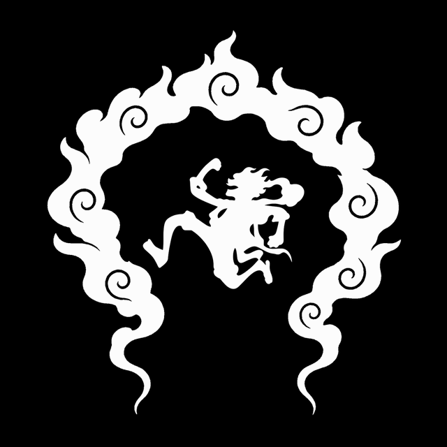
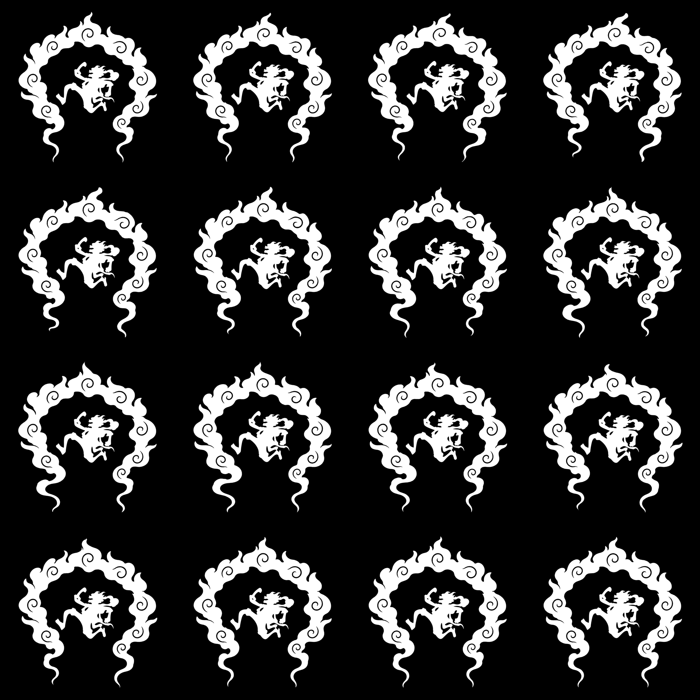

# Luffy Gear 5 — Joy Boy Steam Scarf

**English** · [العربية](README.ar.md)

<a href="README.ar.md"><kbd>🌐 التبديل إلى العربية</kbd></a>

A monochrome Gear 5 / Nika animation: Luffy floats gently inside a flowing white steam-scarf frame on a pure black background.



## Downloads

- [Square video — 1024 × 1024](assets/animation.mp4)
- [Phone video — 1080 × 1920](assets/phone.mp4)
- [Animated GIF — 640 × 640](assets/animation.gif)
- [Download all 300 PNG frames — ZIP](https://github.com/alwansan/luffy-gear-5-joyboy-one-piece/releases/download/frames/frames.zip)
- [Still image](assets/preview.png)

## Animation details

| Property | Value |
| --- | --- |
| Duration | 10 seconds |
| Video frame rate | 30 fps |
| Playback frames | 300 |
| Loop | Matching first and final PNG frames |
| Palette | White artwork on black |
| Movement | Gentle Luffy float and tilt; scarf follow-through and curl motion |

## Artwork and process

Eight AI-generated key drawings establish the cloud-scarf poses. The renderer matches one connected scarf outline and eight internal spiral contours, then creates intermediate shapes using periodic curves. Region timing, curl rotation, and a small character float give the shot its movement. The 300 final frames are rendered inbetweens; they are not 300 independently AI-generated drawings.

The topology checks verify a single connected scarf and eight enclosed spiral marks throughout the sequence. The first and last PNG images match. The GIF uses repeating 30/30/40 ms frame delays because its timing precision differs from video.



## Rebuild locally

Install Python 3.10 or newer and FFmpeg (including ffprobe), then run from the repository root:

```bash
python -m venv .venv
# Activate your virtual environment before continuing.
python -m pip install -r requirements.txt
python scripts/render.py
```

Outputs are created in `build/`, including PNG frames, square and portrait MP4 files, GIF, a storyboard, and validation data. Rendering uses CPU and keeps frames in memory; use a desktop environment for rebuilding.

## Verify the assets

After installing the dependencies and FFmpeg, run:

```bash
python scripts/validate_assets.py --frames /path/to/frames.zip
```

Download the archive from Releases first and replace `/path/to/frames.zip` with its local path. Omit `--frames` to check only the repository media. This checks the archive integrity, 300 PNG frames, matching loop endpoints, video dimensions and timing, GIF loop timing, and file checksums in `assets/manifest.json`.

## Repository contents

- `assets/`: final media, original key drawings, prompts and validation data. The PNG archive is available in Releases.
- `scripts/render.py`: complete renderer, with repository-relative paths.
- `requirements.txt`: Python dependencies.
- `README.ar.md`: Arabic documentation.

## Animation references

Smoke-animation research included [Johannes Fast’s smoke-effects class](https://www.skillshare.com/en/classes/traditional-animation-how-to-create-smoke-effects/2084494770) and the [Ribbon Smoke lesson](https://draw.love-ink-llc.com/animatefx/BCAFXContent/BCAFX_Level-01/0103_03_Smoke.html).
